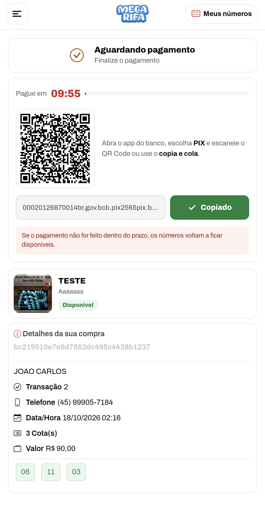

# Mega Rifa

**Sistema de rifas online com PIX, afiliados e painel administrativo.**

---

## 📖 Sobre

Sistema de rifas em PHP com venda de números, pagamentos PIX via Ecompag, afiliados, painel administrativo em `/admin` e gestão de pedidos e usuários.

## ✨ Recursos

| Módulo | Descrição |
|---|---|
| Rifas | Criação e venda de números |
| PIX Ecompag | Depósitos e confirmação |
| Afiliados | Gestão de indicadores |
| Admin | Painel em `/admin` |
| Pedidos | Gestão de reservas e pagamentos |
| Usuários | Cadastro e histórico |

## 🖼️ Prévia

## 📦 Instalação

1. Envie os arquivos para a hospedagem (PHP 8+ e MySQL/MariaDB).
2. Crie o banco e importe `BANCO DE DADOS/rifa.sql`.
3. Configure o banco em `db-config.php` na raiz.
4. Acesse `/admin` com `admin` / `qwe123#` e **troque a senha**.
5. Configure as credenciais da [Ecompag](https://ecompag.com).

## ⬇️ Download

📦 **[Release v1.0](https://github.com/VSFLima/mega-rifa/releases/tag/v1.0)**

| Arquivo | Tamanho |
|---|---|
| [`megarifa.zip`](https://github.com/VSFLima/mega-rifa/releases/download/v1.0/megarifa.zip) | 76 MB |

## ⚠️ Aviso

Este projeto é disponibilizado no estado em que foi recebido, para fins de estudo e implantação. Conteúdo destinado a maiores de 18 anos. Jogue com responsabilidade. A legalidade de apostas varia de país para país — verifique a legislação local. Troque todas as credenciais padrão antes de usar em produção.

## 🙏 Créditos

- **Distribuição:** [@vsf_lima](https://t.me/vsf_lima) — Telegram
- **Sistema original:** datafy.click / ecompag

---

Feito com ❤️ para a comunidade — <a href="https://t.me/vsf_lima">@vsf_lima</a>

